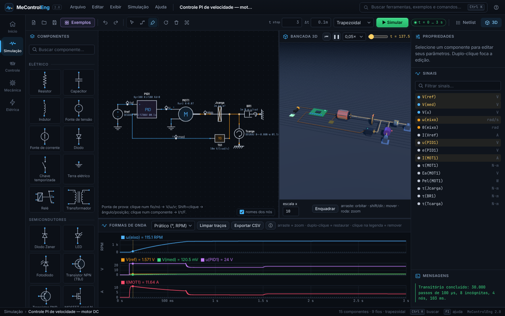
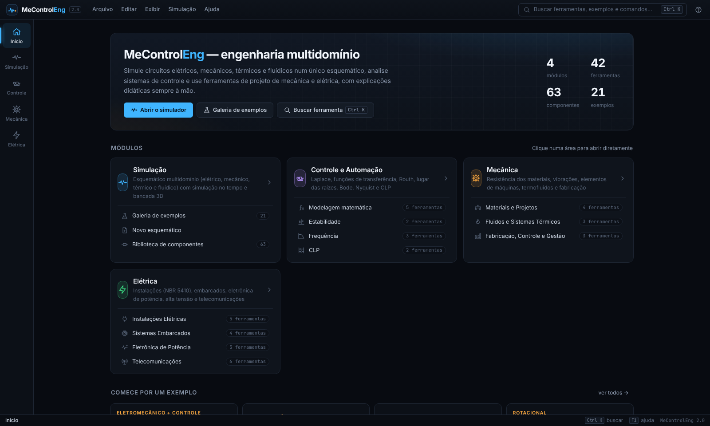

# MeControlEng — ambiente de engenharia: simulação multidomínio, controle e automação

Simulador de circuitos **elétricos/eletrônicos, mecânicos (rotacionais e translacionais), térmicos, fluídicos e eletromecânicos** num único esquemático, com análise transitória, visualizador de formas de onda e uma **bancada 3D animada** (Three.js). Evolução do simulador de controle de velocidade de motor DC do Grupo 8: o motor, o PI e o tacômetro agora são componentes que você liga como quiser.



> Abra `index.html` no navegador (funciona offline, inclusive via `file://`). Não precisa de servidor nem de instalação.

## Recursos

- **Editor de esquemático** com grade, fios ortogonais, junções em T, rótulos de nó, girar/duplicar/excluir, seleção por caixa, desfazer/refazer, zoom e pan.
- **Solver MNA** (Modified Nodal Analysis), o mesmo princípio do SPICE, estendido para vários domínios:
  - integração **Trapezoidal** (padrão) ou **Euler implícito**, com passo fixo;
  - **Newton-Raphson** com limitação de junção para não lineares (diodo);
  - fatoração LU reaproveitada quando o circuito é linear (rápido: ~30 000 passos em ~0,2 s).
- **Formas de onda** em painéis por unidade, cursor com leitura, zoom por arrasto e exportação em CSV. Opção de unidades práticas (RPM, graus).
- **Ponta de prova** como no LTspice: clique num fio para ver V / ω / v, Shift+clique para θ / x e clique num componente para I / τ / F.
- **Bancada 3D**: eixos giram com θ(t), engrenagens engrenam, molas esticam e torcem, massas deslizam, amortecedores mostram o pistão, motores esquentam (emissivo) com a corrente, e a chave liga e desliga. A reprodução fica sincronizada com o cursor do gráfico.
- **Netlist textual**, salvar/abrir em JSON e salvamento automático no navegador.
- **21 exemplos**, entre eles: fonte de alimentação completa (transformador + ponte + filtro + 7805), contador 0–9 com 555 + 4026 + display, relé acionado por transistor, PWM com MOSFET, AmpOp inversor, Zener, fotodiodo, aquecimento e controle PID de temperatura, nível de tanque, controle de nível PID com válvula proporcional, cilindro hidráulico e os exemplos originais: controle PI de motor DC, motor em malha aberta, massa-mola-amortecedor, redutor com eixo flexível, pinhão-cremalheira, analogia RLC × massa-mola, RC e retificador.

## Interface (versão 2.0)



- **Tela Início** com visão geral dos módulos, contagem de ferramentas, atalhos para as áreas e exemplos.
- **Barra lateral de módulos** (Início · Simulação · Controle · Mecânica · Elétrica), **abas de área** com ícones e **lista numerada de ferramentas**, recolhível.
- **Barra de menus** (Arquivo, Editar, Exibir, Simulação, Ajuda) e **busca global `Ctrl+K`**, que encontra qualquer ferramenta, área, exemplo, componente ou comando.
- **Barra de ferramentas da simulação** separada do topo: arquivo, edição, modos de edição, parâmetros de integração, botão Simular e estado do resultado.
- **Barra de status** com a trilha de navegação (módulo › área › ferramenta) e informações do contexto.
- **Design system** próprio: superfícies em grafite azulado, acento azul de sinal, tipografia Inter + JetBrains Mono, ícones vetoriais, cartões com resultados em tabela chave-valor, tabelas com cabeçalho fixo, unidades em etiquetas nos campos.
- **Gráficos** com legenda em caixa, mira (crosshair) e leitura em balão; exportação em **PNG** pelo botão que aparece ao passar o mouse.
- Atalhos: `Ctrl+K` busca, `F1` ajuda, `Ctrl+Enter`/`F9` simular, `Ctrl+S`/`Ctrl+O`, `Ctrl+Z`/`Ctrl+Y`, `W`/`P`/`G`/`R`/`F`/`Del`, `Espaço`.

## Organização das abas

| Aba principal | Conteúdo |
|---|---|
| **Simulação** | esquemático multidomínio, transitório, gráficos, bancada 3D (aba principal) |
| **Controle e Automação** | sub-abas **Modelagem matemática**, **Estabilidade**, **Frequência** e **CLP** |
| **Mecânica** | sub-abas **Materiais e Projetos**, **Fluidos e Sistemas Térmicos** e **Fabricação, Controle e Gestão Industrial** |
| **Elétrica** | sub-abas **Instalações Elétricas**, **Sistemas Embarcados**, **Eletrônica de Potência** (com Alta Tensão) e **Telecomunicações** |

### Mecânica

| Sub-aba | Ferramenta | Seções |
|---|---|---|
| Materiais e Projetos | Resistência dos Materiais | vigas (reações, V, M, σ, τ, flecha com cargas concentradas, distribuídas e momentos; biapoiada, com balanço ou engastada) · círculo de Mohr (σ₁, σ₂, τmáx, von Mises, Tresca, elemento girado) · flambagem (Euler/Johnson) |
| | Dinâmica e Vibrações | vibração livre com animação · forçada (fator de amplificação, fase, resposta transitória por RK4) · isolamento (transmissibilidade, dimensionamento de coxins) |
| | Elementos de Máquinas e Projeto Mecânico | eixos (von Mises estático e DE-Goodman) · engrenagens (geometria, esforços, Lewis, animação) · rolamentos (L₁₀, confiabilidade) · parafusos (pré-carga, torque, diagrama da junta) · fadiga (Marin, Goodman, Soderberg, Gerber, Langer) |
| | Ciência e Seleção de Materiais | banco com 30 materiais · gráfico de Ashby log-log com linhas de índice · ranking por índice de desempenho com restrições · curvas tensão-deformação (resiliência e tenacidade) |
| Fluidos e Sistemas Térmicos | Termodinâmica | processos com gás ideal (P-v e T-s, W, Q, ΔU, ΔS) · ciclos Otto, Diesel, Brayton e Carnot |
| | Mecânica dos Fluidos e Fenômenos de Transporte | tubulação com Colebrook e diagrama de Moody · ponto de operação bomba × sistema (série/paralelo) · Venturi com piezômetros |
| | Transferência de Calor | parede composta plana/cilíndrica (raio crítico) · aletas (η, ε, perfil) · condução transiente 1D por diferenças finitas, animada |
| Fabricação, Controle e Gestão Industrial | Processos de Fabricação | torneamento, fresamento, furação (n, Vf, Q, kc de Kienzle, Fc, Pc, Ra) · Taylor e velocidade de mínimo custo / máxima produção |
| | Metrologia e Controle | tolerâncias e ajustes ISO 286 (furo-base) · CEP com cartas X̄-R, Cp/Cpk e histograma · paquímetro virtual com correção |
| | Manutenção e Gestão | Weibull (R, F, λ, MTTF, B10) e intervalo ótimo de preventiva · MTBF, MTTR, disponibilidade e OEE · Pareto/ABC |

### Elétrica

| Sub-aba | Ferramenta | Seções |
|---|---|---|
| Instalações Elétricas | Dimensionamento de condutores | NBR 5410: corrente de projeto, métodos B1/B2/A1/C/D, fatores de temperatura e agrupamento, queda de tensão, seção mínima, disjuntor (IB ≤ In ≤ Iz), neutro e PE |
| | Normas Técnicas e Segurança | fichas pesquisáveis (NBR 5410, 14039, 5419, 5418 → IEC 60079, 14136, NR-10, 16690, 17019, 8995, 61439, 13534, 15749) · zonas de choque IEC 60479 · distâncias da NR-10 · grau IP |
| | Dispositivos de Proteção e Aterramento | curvas B/C/D · DR e tensão de contato no TT · esquemas TN-S/TN-C/TN-C-S/TT/IT · hastes e malhas · curto-circuito e Icu · SPDA por esfera rolante |
| | Projeto, Infraestrutura e Execução | previsão de cargas · quadro de cargas com balanceamento de fases · eletrodutos (taxa de ocupação) · método dos lúmens · ensaios e desenergização NR-10 |
| | Aplicações Especiais e Tendências | motores (direta, Y-Δ, soft-starter, inversor) · comandos elétricos animados (selo, reversão, estrela-triângulo) · fotovoltaica (I-V, strings, payback) · recarga de veículos elétricos · automação residencial com regras |
| Sistemas Embarcados | Simulador Arduino | sketches em C/C++ (setup/loop, digital/analog, PWM, millis, Serial, Servo, tone) numa placa virtual com LEDs, botões, potenciômetro, LM35, LDR, servo e buzzer · monitor e plotter serial · 10 exemplos |
| | Plataformas e pinagens | Arduino, ESP8266/ESP32, Pico, STM32, PIC, Raspberry Pi · pinagem do Uno · arquitetura e boas práticas |
| | Protocolos de comunicação | diagramas de tempo UART, I²C e SPI para o byte escolhido · comparativo (RS-485, CAN, 1-Wire, USB…) |
| | Calculadoras de hardware | resistor de LED · divisor e ADC · timer/PWM do ATmega328P (registradores) · transistor como chave · autonomia de bateria |
| Eletrônica de Potência | Retificadores | meia-onda, ponte mono e trifásica, diodo e SCR (α), Vdc × α, FP, harmônicos e THD |
| | Conversores CC-CC | buck, boost e buck-boost simulados chave a chave (partida, ripple, MCC/MCD) |
| | Inversores PWM | onda quadrada, SPWM bipolar/unipolar e trifásico, corrente RL, espectro e THD |
| | Semicondutores e perdas | comparativo SCR…GaN · mapa potência × frequência · perdas de condução/chaveamento e dissipador |
| | Alta Tensão | campo coaxial (raio ótimo) · Paschen · corona (Peek) · impulso 1,2/50 µs e gerador de Marx · ondas viajantes (treliça de Bewley) · cadeia de isoladores · coordenação de isolamento · HVDC · equipamentos e ensaios |
| Telecomunicações | Sinais e amostragem | série de Fourier (Gibbs) · Nyquist e aliasing · quantização (SQNR) |
| | Modulação analógica | AM, DSB-SC, SSB · FM com raias de Bessel e Carson |
| | Modulação digital | ASK/FSK/BPSK · constelações com ruído (Monte Carlo) · BER × Eb/N0 |
| | Enlaces e propagação | orçamento de potência (Friis) · zona de Fresnel e altura de antenas · Shannon · fibra óptica |
| | Linhas e antenas | Γ, ROE e onda estacionária animada · carta de Smith · cabo coaxial · arranjos de antenas com direcionamento de feixe |
| | Sistemas e redes | espectro, gerações celulares, Wi-Fi/IoT, modelo OSI |

### CLP (Ladder)

Editor de diagrama Ladder com simulação do **ciclo de varredura** (50 ms): contatos NA, NF e de borda (P/N), bobinas ( ), (/), SET, RESET, temporizadores **TON/TOF**, contador **CTU**, ramos paralelos e comentários. Os endereços seguem o estilo IEC/Siemens (I0.x, Q0.x, M, T, C) com tabela de nomes (tags) e valores em tempo real. O painel virtual tem botões (pulso) e chaves de entrada, lâmpadas de saída e plantas animadas: **partida de motor**, **tanque com sensores de nível** e **semáforo**. Exemplos: partida com selo, pisca-pisca, semáforo, nível com SET/RESET, contador de peças e reversão com intertravamento.

## Sub-abas de Modelagem, Estabilidade e Frequência

Elas compartilham um mesmo sistema de controle, com **G(s)**, **H(s)** e **K** editáveis em qualquer uma delas, e **G(s) pode vir direto do esquemático**:

| Aba | Ferramentas |
|---|---|
| **ƒ Modelagem matemática** | Função de transferência (forma polinomial e fatorada, polos e zeros, tipo, ζ e ωn, respostas ao degrau, impulso e rampa, Mp, tr, ts) · Transformada de Laplace (tabela, propriedades, inversa por frações parciais inclusive com polos repetidos/complexos, valor inicial e final) · Diagrama de blocos ↔ grafo de fluxo de sinal com **regra de Mason** passo a passo (caminhos, laços, laços que não se tocam, Δ e Δk) · Espaço de estados (formas canônicas, G(s) ⇄ A,B,C,D, controlabilidade e observabilidade) · **Do esquemático → G(s)** |
| **⚖ Estabilidade** | Routh-Hurwitz (tabela, ε e linha nula, faixa de K estável, frequência de oscilação) · Lugar das raízes (assíntotas, separação, ângulos de partida, cruzamento com jω, linhas de ζ, K por clique, resposta em malha fechada) |
| **∿ Frequência** | Resposta em frequência (senoide de entrada × saída, transitório e regime) · Bode (exato e assintótico, margens de ganho e fase, largura de banda, Mr) · Nyquist (contorno com indentações, contagem de voltas, Z = N + P, compressão logarítmica) |

**Parte didática:** cada ferramenta tem um painel **📘 Entenda** recolhido por padrão, com a teoria resumida, fórmulas e simplificações. Cada componente do esquemático tem uma seção **📘 Sobre o componente**, com equação constitutiva, análogo nos outros domínios e uma dica prática. O botão ⓘ do visualizador explica os tipos de sinal e de gráfico.

**Esquemático → G(s):** monta a MNA em s (A(s)·X = b·U), avalia det A(s) e Y/U em pontos de um círculo e recupera os polinômios por DFT. Subcircuitos desacoplados são descartados e pares polo-zero coincidentes são cancelados. As simplificações aplicadas (linearização, superposição, CI nulas) são listadas junto ao resultado.

## Biblioteca de componentes

| Domínio | Componentes |
|---|---|
| Elétrico | Resistor, Capacitor, Indutor, Fonte de tensão, Fonte de corrente, Diodo, Chave temporizada, Terra, **Relé**, **Transformador** |
| Semicondutores | **Diodo Zener**, **LED** (5 cores, acende no esquemático e no 3D), **Fotodiodo**, **Transistores NPN e PNP** (Ebers-Moll), **MOSFET canal N e P** |
| CIs e digitais | **Regulador 78xx**, **Amplificador operacional**, **Porta lógica 74xx** (AND/OR/NAND/NOR/XOR/NOT), **Contador 4026** com decodificador, **Display de 7 segmentos**, **Temporizador 555** |
| Instrumentos | **Voltímetro** e **Amperímetro** (leitura ao vivo no esquemático) |
| Térmico | Resistência térmica, Convecção (h·A), Capacitância térmica (m·c), Fonte de temperatura, Fonte de calor, Referência, **Resistor de aquecimento** (elétrico → térmico), **Sensor LM35** |
| Fluídico | Resistência hidráulica, Inertância, **Tanque**, Fontes de pressão e de vazão, Referência atmosférica, **Bomba acionada por eixo** (ω → Q), **Cilindro hidráulico** (p → F), **Válvula proporcional**, **Sensor de nível** |
| Rotacional | Inércia (volante), Mola torcional, Amortecedor rotacional, Fonte de torque, Fonte de vel. angular, Mancal fixo, Engrenagem/redutor |
| Translacional | Massa, Mola, Amortecedor, Fonte de força, Fonte de velocidade, Parede |
| Eletromecânico | Motor DC (Ra, La, K, J, B), Atuador linear de bobina móvel (Bl), Pinhão-cremalheira |
| Controle e sensores | Controlador PID (com saturação e anti-windup), Tacômetro (ω → V), Sensor de velocidade (v → V), Rótulo de nó |

Fontes aceitam as formas **DC, DEGRAU, SENO e PULSO**.

## Como funciona: a analogia força-corrente

Todo nó tem uma variável **"através"** (across) e todo ramo uma variável **"por"** (through):

| | Elétrico | Rotacional | Translacional |
|---|---|---|---|
| Nó (across) | V | ω | v |
| Ramo (through) | I | τ | F |
| Armazena energia cinética | C (ao terra) | J (ao referencial) | m (ao referencial) |
| Armazena energia potencial | L | mola: L = 1/k | mola: L = 1/k |
| Dissipa | R | amortecedor: R = 1/b | amortecedor: R = 1/b |

Os acoplamentos entram como **ramos extras** da matriz MNA:

- **Engrenagem** (transformador ideal): `ω_ent = n·ω_saí` e `τ_saí = n·τ_ent`. Com "inverte sentido = sim", n fica negativo, como num par externo.
- **Pinhão-cremalheira**: transformador com `n = 1/r`, ou seja, `v = r·ω` e `F = τ/r`.
- **Motor DC** (girador): `Va − Vb = Ra·i + La·di/dt + K·ω` e `τ = K·i`. A carcaça fica presa ao referencial.
- **Tacômetro / sensor**: fonte de tensão controlada `V = K·ω`, sem carregar o eixo.
- **PID**: controlador digital amostrado a cada passo, `u = Kp·e + ∫Ki·e dt + Kd·de/dt`, com saturação [Umin, Umax] e integração condicional.

Ângulos e posições (θ, x) vêm da integração trapezoidal das velocidades dos nós. São eles que movem a animação 3D.

## Arquitetura dos arquivos

```
mecontroleng/
├── index.html          interface
├── css/style.css       tema escuro
├── js/core.js          utilidades, prefixos SI, formas de onda, biblioteca de componentes (símbolos)
├── js/solver.js        netlist (conectividade), montagem MNA, LU, transitório, Newton
├── js/editor.js        editor de esquemático (canvas 2D)
├── js/plot.js          visualizador de formas de onda
├── js/view3d.js        bancada 3D (Three.js)
├── js/examples.js      exemplos prontos
├── js/shell.js          interface: ícones, menus, busca Ctrl+K, tela Início, status
├── js/app.js           integração da interface, arquivos, reprodução, atalhos, abas
├── js/info.js          textos didáticos dos componentes
├── js/parts/devices.js     modelos não lineares (junção, BJT, MOSFET, regulador, AmpOp)
├── js/parts/electronics.js componentes eletrônicos (símbolo, modelo, visual ao vivo, 3D)
├── js/parts/thermofluid.js domínios térmico e fluídico
├── js/ctrl/plc.js      CLP: editor Ladder, ciclo de varredura, plantas virtuais
├── js/mech/kit.js         utilitários da Mecânica (formulários, seções, banco de materiais)
├── js/mech/materiais.js   Materiais e Projetos
├── js/mech/termofluidos.js Fluidos e Sistemas Térmicos
├── js/mech/fabricacao.js  Fabricação, Controle e Gestão Industrial
├── js/elec/instalacoes.js Instalações Elétricas
├── js/elec/embarcados.js  Sistemas Embarcados (simulador Arduino)
├── js/elec/potencia.js    Eletrônica de Potência e Alta Tensão
├── js/elec/telecom.js     Telecomunicações
├── js/ctrl/math.js     polinômios, raízes (Aberth), parser de G(s), frações parciais, espaço de estados, respostas
├── js/ctrl/extract.js  esquemático → G(s)
├── js/ctrl/chart.js    gráfico genérico (log, zoom, leitura)
├── js/ctrl/ui.js       sistema compartilhado (G, H, K), barra do sistema, páginas e painel "Entenda"
├── js/ctrl/blockdiag.js editor de diagrama de blocos, grafo de fluxo de sinal e regra de Mason
├── js/ctrl/tab-model.js aba Modelagem
├── js/ctrl/tab-stab.js  aba Estabilidade (Routh, lugar das raízes)
├── js/ctrl/tab-freq.js  aba Frequência (resposta em frequência, Bode, Nyquist)
└── vendor/three.min.js Three.js r149 (MIT), embutido para funcionar offline
```

### Para adicionar um componente novo (arquitetura de plugins)

Crie uma entrada em `MS.DEFS` (veja `js/parts/*.js`) com:
- `pins`: `[x, y, domínio, nome]`, `params`, `draw(g, c, S)` (símbolo);
- `build(x)`: traduz o componente em elementos primitivos — `G`, `C`, `L`, `V`, `I`, `XF` (transformador), `GY` (girador), `EMC`, `E` (fonte controlada), `NL` (não linear com Newton: devolve correntes e jacobiano), `CTRL` (lógica amostrada a cada passo: digitais, relés, válvulas) — e declara grandezas com `x.Q(...)`;
- opcionais: `live(g, c, S)` (visual ao vivo no esquemático, usando `S.q('grandeza')`) e `view3d(k)` (peça 3D).

## Atalhos

`W` fio · `R` girar · `P` ponta de prova · `G` terra · `Del` excluir · `Ctrl+D` duplicar · `Ctrl+Z / Ctrl+Y` desfazer/refazer · `F` enquadrar · `Ctrl+Enter` ou `F9` simular · `Espaço` play/pausa · `Ctrl+S / Ctrl+O` salvar/abrir.

Valores usam prefixos SPICE: `f p n u µ m k M meg G` (atenção: `m` = mili, `M`/`meg` = mega).

## Validação

O solver confere com as soluções analíticas:

- massa-mola-amortecedor (m = 1, k = 100, b = 2, F = 10 N): pico de 0,17292 m, contra 0,17292 m da fórmula `x∞·(1 + e^(−πζ/√(1−ζ²)))`;
- circuito RC: V(τ) = 3,151 V, contra o teórico 5·(1 − e⁻¹) = 3,161 V com passo de 10 µs;
- redutor 1:5 invertido: ω_saída = −ω_motor/5, exato;
- analogia: V(v_el) e v(v_mec) idênticos amostra a amostra;
- esquemático → G(s): massa-mola dá 1/(s² + 2s + 100), RC dá 1000/(s + 1000) e o circuito da analogia elétrica dá s/(s² + 2s + 100);
- K/(s(s+2)(s+4)): Routh e lugar das raízes dão K crítico = 48 e ω = 2,83 rad/s; com K = 10, Bode dá MG = 13,6 dB = 20·log(48/10) e MF = 47°;
- Nyquist de (s+2)/((s−1)(s+3)) com K = 4: P = 1, N = −1, Z = 0 (estável), conferido pelas raízes;
- Mecânica: viga biapoiada com P central dá Mmáx = PL/4 e flecha = PL³/48EI; engastada com carga distribuída dá flecha = wL⁴/8EI; fator de atrito confere com Blasius e com o regime totalmente rugoso; ajustes ISO conferem com a tabela (H7/g6 Ø25: −7/−20 µm; H7/p6: +22/+35 µm);
- Mason confere com a redução de blocos, inclusive com laços que não se tocam (Δ = 1 − (L1+L2) + L1·L2).
