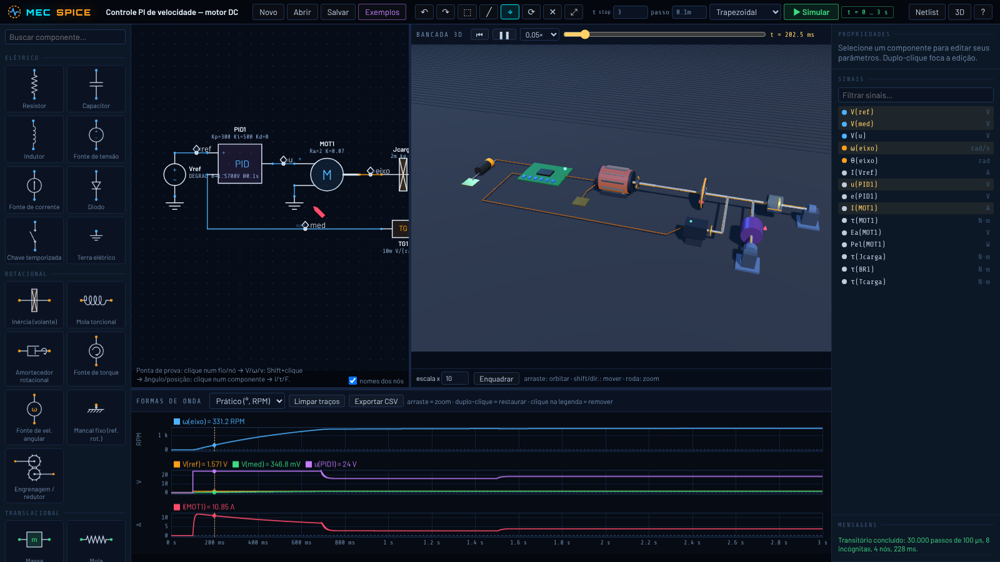

# MecSPICE — simulador multidomínio (elétrico + mecânico) estilo LTspice

Simulador de circuitos **elétricos, mecânicos rotacionais, mecânicos translacionais e eletromecânicos** num único esquemático, com análise transitória, visualizador de formas de onda e uma **bancada 3D animada** (Three.js). Evolução do simulador de controle de velocidade de motor DC do Grupo 8: o motor, o PI e o tacômetro agora são componentes que você liga como quiser.



> Abra `index.html` no navegador (funciona offline, inclusive via `file://`). Não precisa de servidor nem de instalação.

## Recursos

- **Editor de esquemático** com grade, fios ortogonais, junções em T, rótulos de nó, girar/duplicar/excluir, seleção por caixa, desfazer/refazer, zoom e pan.
- **Solver MNA** (Modified Nodal Analysis), o mesmo princípio do SPICE, estendido para vários domínios:
  - integração **Trapezoidal** (padrão) ou **Euler implícito**, com passo fixo;
  - **Newton-Raphson** com limitação de junção para não lineares (diodo);
  - fatoração LU reaproveitada quando o circuito é linear (rápido: ~30 000 passos em ~0,2 s).
- **Formas de onda** em painéis por unidade, cursor com leitura, zoom por arrasto e exportação em CSV. Opção de unidades práticas (RPM, graus).
- **Ponta de prova** como no LTspice: clique num fio para ver V / ω / v, Shift+clique para θ / x e clique num componente para I / τ / F.
- **Bancada 3D**: eixos giram com θ(t), engrenagens engrenam, molas esticam e torcem, massas deslizam, amortecedores mostram o pistão, motores esquentam (emissivo) com a corrente, e a chave liga e desliga. A reprodução fica sincronizada com o cursor do gráfico.
- **Netlist textual**, salvar/abrir em JSON e salvamento automático no navegador.
- **8 exemplos**: controle PI de motor DC, motor em malha aberta, massa-mola-amortecedor, redutor com eixo flexível, pinhão-cremalheira, analogia RLC × massa-mola, RC e retificador.

## Biblioteca de componentes

| Domínio | Componentes |
|---|---|
| Elétrico | Resistor, Capacitor, Indutor, Fonte de tensão, Fonte de corrente, Diodo, Chave temporizada, Terra |
| Rotacional | Inércia (volante), Mola torcional, Amortecedor rotacional, Fonte de torque, Fonte de vel. angular, Mancal fixo, Engrenagem/redutor |
| Translacional | Massa, Mola, Amortecedor, Fonte de força, Fonte de velocidade, Parede |
| Eletromecânico | Motor DC (Ra, La, K, J, B), Atuador linear de bobina móvel (Bl), Pinhão-cremalheira |
| Controle e sensores | Controlador PID (com saturação e anti-windup), Tacômetro (ω → V), Sensor de velocidade (v → V), Rótulo de nó |

Fontes aceitam as formas **DC, DEGRAU, SENO e PULSO**.

## Como funciona: a analogia força-corrente

Todo nó tem uma variável **"através"** (across) e todo ramo uma variável **"por"** (through):

| | Elétrico | Rotacional | Translacional |
|---|---|---|---|
| Nó (across) | V | ω | v |
| Ramo (through) | I | τ | F |
| Armazena energia cinética | C (ao terra) | J (ao referencial) | m (ao referencial) |
| Armazena energia potencial | L | mola: L = 1/k | mola: L = 1/k |
| Dissipa | R | amortecedor: R = 1/b | amortecedor: R = 1/b |

Os acoplamentos entram como **ramos extras** da matriz MNA:

- **Engrenagem** (transformador ideal): `ω_ent = n·ω_saí` e `τ_saí = n·τ_ent`. Com "inverte sentido = sim", n fica negativo, como num par externo.
- **Pinhão-cremalheira**: transformador com `n = 1/r`, ou seja, `v = r·ω` e `F = τ/r`.
- **Motor DC** (girador): `Va − Vb = Ra·i + La·di/dt + K·ω` e `τ = K·i`. A carcaça fica presa ao referencial.
- **Tacômetro / sensor**: fonte de tensão controlada `V = K·ω`, sem carregar o eixo.
- **PID**: controlador digital amostrado a cada passo, `u = Kp·e + ∫Ki·e dt + Kd·de/dt`, com saturação [Umin, Umax] e integração condicional.

Ângulos e posições (θ, x) vêm da integração trapezoidal das velocidades dos nós. São eles que movem a animação 3D.

## Arquitetura dos arquivos

```
mecspice/
├── index.html          interface
├── css/style.css       tema escuro
├── js/core.js          utilidades, prefixos SI, formas de onda, biblioteca de componentes (símbolos)
├── js/solver.js        netlist (conectividade), montagem MNA, LU, transitório, Newton
├── js/editor.js        editor de esquemático (canvas 2D)
├── js/plot.js          visualizador de formas de onda
├── js/view3d.js        bancada 3D (Three.js)
├── js/examples.js      exemplos prontos
├── js/app.js           integração da interface, arquivos, reprodução, atalhos
└── vendor/three.min.js Three.js r149 (MIT), embutido para funcionar offline
```

### Para adicionar um componente novo

1. Em `core.js`, crie uma entrada em `MS.DEFS` com pinos `[x, y, domínio, nome]`, parâmetros e a função `draw`.
2. Em `solver.js`, dentro de `MS.buildCircuit`, traduza o componente em elementos primitivos (`G`, `C`, `L`, `V`, `I`, `D`, `XF`, `EMC`, `E`...) e declare as grandezas plotáveis com `Q(...)`.
3. Se quiser, em `view3d.js`, acrescente um `case` com a geometria 3D e a função de atualização.

## Atalhos

`W` fio · `R` girar · `P` ponta de prova · `G` terra · `Del` excluir · `Ctrl+D` duplicar · `Ctrl+Z / Ctrl+Y` desfazer/refazer · `F` enquadrar · `Ctrl+Enter` ou `F9` simular · `Espaço` play/pausa · `Ctrl+S / Ctrl+O` salvar/abrir.

Valores usam prefixos SPICE: `f p n u µ m k M meg G` (atenção: `m` = mili, `M`/`meg` = mega).

## Validação

O solver confere com as soluções analíticas:

- massa-mola-amortecedor (m = 1, k = 100, b = 2, F = 10 N): pico de 0,17292 m, contra 0,17292 m da fórmula `x∞·(1 + e^(−πζ/√(1−ζ²)))`;
- circuito RC: V(τ) = 3,151 V, contra o teórico 5·(1 − e⁻¹) = 3,161 V com passo de 10 µs;
- redutor 1:5 invertido: ω_saída = −ω_motor/5, exato;
- analogia: V(v_el) e v(v_mec) idênticos amostra a amostra.
